# *Klebsiella pneumoniae* One Health Genomics: Bioinformatics Workflow

> **Distribution of antibiotic resistance and virulence genes in *K. pneumoniae* across animal, clinical and environmental sources: a One Health genomic comparison.**

A single-author independent study using **public NCBI genomes**, free bioinformatics tools and Python.
This repository holds the code that takes the project from a raw NCBI metadata sheet to a clean, quality-checked, balanced set of **210 genomes** with annotation results collected in one Excel workbook.

---

## Why this project?

*K. pneumoniae* is a WHO critical-priority pathogen. Some strains are multidrug resistant, some are hypervirulent, and *convergent* strains carry both. This study asks whether resistance and virulence genes look similar across **human (clinical), animal and environmental** isolates, and across **five continents**.

---

## Workflow at a glance

```mermaid
flowchart LR
    A["NCBI Pathogen Detection<br/>metadata (CSV)"] --> B["1. Clean + group + sample<br/>(Jupyter, pandas)"]
    B -->|"300 accessions"| C["2. Download genomes<br/>(Bash, NCBI datasets)"]
    C -->|"300 .fna files"| D["3. Quality control<br/>(Kaggle, CheckM2, Kleborate)"]
    D -->|"273 pass, then balance"| E["210 genomes → BV-BRC<br/>CGA annotation"]
    E --> F["4. Extract results<br/>(Python, requests)"]
    F --> G[("Excel workbook<br/>15 sheets")]
    G -.-> H["Next: phylogeny,<br/>statistics, figures"]
```



| Stage | What happens | Tool | Input → Output |
|:--:|---|---|---|
| **1** | Clean metadata, group sources, add continent, sample | Python (pandas) | NCBI CSV → 300 accessions |
| **2** | Download the genomes | Bash + NCBI `datasets` | Accession lists → 300 `.fna` files |
| **3** | Remove duplicates, check quality, confirm species | Python, CheckM2, Kleborate | 300 genomes → KEEP / EXCLUDE |
| **4** | Collect BV-BRC annotation results | Python (requests, pandas) | 210 CGA jobs → one Excel workbook |

**Sample numbers:** `300` sampled → `290` unique → `273` pass QC → `210` balanced (3 groups × 5 continents × 14 genomes).

---

## Repository contents

```
├── QC results/
│   ├── Kp_QC_report.xlsx                # Stage 3: full QC report
│   └── qc_results_all.csv.xlsx          # Stage 3: QC results for all 300 genomes
├── docs/
│   ├── Sampling design KP 210.xlsx      # balanced 210-genome design (input of Stage 4)
│   └── requirements.txt                 # the computational tools required to run the project
│   └── study-workflow.png               # study workflow figure
├── scripts/
│   ├── kp_amr_workflow.ipynb            # Stage 1: metadata cleaning + sampling
│   ├── kp_isolation_groups.py           # Module: isolation source -> Clinical / Environmental / Animal
│   ├── kp_continent_groups.py           # Module: country -> continent
│   ├── download_kp_genomes.sh           # Stage 2: genome download
│   ├── kp_qc_workflow.ipynb             # Stage 3: genome quality control (Kaggle)
│   └── BV_BRC CGA results extractor.py  # Stage 4: BV-BRC result extraction
├── .gitignore
└── README.md
```

---

## Stage 1: Metadata cleaning and sampling

**Files:** `scripts/kp_amr_workflow.ipynb`, `scripts/kp_isolation_groups.py`, `scripts/kp_continent_groups.py`
**Goal:** turn messy NCBI metadata into a clean table, then draw a balanced sample of 300 genomes.

### Part A: cleaning

| Step | What it does |
|:--:|---|
| 1–2 | Load the CSV, drop unused columns (`Strain`, `Isolate`, `BioSample`) and rows with empty cells |
| 3 | Pull a 4-digit **collection year** out of messy dates using the regex `(\d{4})` |
| 4 | Lowercase text and turn hidden missing words ("unknown", "not collected", ...) into real `NaN` |
| 5 | Set impossible years (e.g. the 1900 placeholder) to missing; keep 1990–2025 |
| 6 | Drop rows missing `Location`, `Isolation_source` or `Collection_year` |
| 7 | **Audit:** confirm zero `NaN` and zero leftover missing words |
| 8 | Add `Isolation_Group` (see below) |
| 9 | Save `Kp_clean.csv` |

### Module 1: `kp_isolation_groups.py`
Collapses **2,908 different isolation-source strings** into four groups (One Health idea).

| Group | Examples |
|---|---|
| **Clinical** | blood, urine, sputum, wound, stool |
| **Environmental** | water, wastewater, soil, hospital sinks |
| **Animal** | livestock, poultry, pets, meat, milk |
| **Unclassified** | lab mutants, bare codes, "other" (kept separate on purpose) |

It works in **two layers**:
1. **Hand-checked lists** (2,029 clinical, 431 environmental, 307 animal, 141 unclassified strings) are the dictionary lookup.
2. **Keyword rules (regex)** are the fallback for new or misspelled values, so the pipeline does not break on future downloads.

### Module 2: `kp_continent_groups.py`
Takes the country from the `Location` text (before the first `:`) and looks it up in a country → continent table (UN geoscheme). Longest names are matched first, so `"south africa"` is never confused with `"africa"` and `"niger"` never matches `"nigeria"`. Unplaceable values become `Unknown`.

### Part B: sampling

| Step | What it does |
|:--:|---|
| 10 | Add `Continent` |
| 11 | Keep genomes collected in **2018 or later** |
| 12 | Count genomes in every group × continent "box" (so `.sample()` never crashes on a small box) |
| 13 | **Stratified random sample:** 20 genomes per box, `random_state=42` for reproducibility |
| 14 | Save `Kp_sample.csv` plus one accession list per group |

```python
# 3 groups x 5 continents x 20 genomes = 300
sample = (df[df["Isolation_Group"].isin(SAMPLE_GROUPS) & df["Continent"].isin(SAMPLE_CONTINENTS)]
            .groupby(["Isolation_Group", "Continent"])
            .sample(n=20, random_state=42))
```

**Why stratified?** About 90% of the public data is clinical. A simple random sample would be almost all clinical, so equal draws keep the three sources comparable.

**Outputs:** `Kp_clean.csv`, `Kp_sample.csv`, `clinical_assembly.txt`, `environmental_assembly.txt`, `animal_assembly.txt`

> Oceania is left out of the sample because it has no animal genomes from 2018 onward.
> The notebook also has an optional switch (`DROP_GCA_DUPLICATES`) to remove GenBank copies of genomes that are also in RefSeq.

---

## Stage 2: Genome download

**File:** `scripts/download_kp_genomes.sh` (Bash on Ubuntu / WSL)
**Goal:** download every genome in the three accession lists.

| Step | What it does |
|:--:|---|
| **Prepare** | Check that `datasets` and `unzip` are installed; make `Animal/`, `Clinical/`, `Environmental/` folders |
| **Skip** | If the `.fna` file already exists, skip it (safe to re-run) |
| **Download** | `datasets download genome accession ...` into a temporary zip |
| **Extract** | Keep only the `.fna` genome file |
| **Log** | Write `SUCCESS` or `FAILED` to `download_log.txt` |
| **Count** | Print expected vs. downloaded genomes per group |

**Run:** edit `BASE` at the top of the script to your own folder, then `bash scripts/download_kp_genomes.sh`

---

## Stage 3: Genome quality control

**File:** `scripts/kp_qc_workflow.ipynb` (runs on Kaggle, CPU only)
**Goal:** keep only high-quality, non-duplicate *K. pneumoniae* genomes.

| Step | What it does |
|:--:|---|
| 1–2 | Setup, then build a **manifest** matching each genome file to a Sample ID (`KP001`–`KP300`) |
| 3 | Own FASTA statistics (contigs, size, N50, GC%) and **MD5 duplicate check** |
| 4–6 | Install CheckM2 and Kleborate in conda environments and test them |
| 7 | **Kleborate:** species and contig statistics (batches of 50) |
| 8 | **CheckM2:** completeness and contamination (batches of 25) |
| 9 | Apply the QC rule, make the **KEEP / EXCLUDE** decision, write the report |
| 10 | Zip the results |

### QC rule (fixed *before* looking at results)

| Criterion | Threshold | Measured with |
|---|---|---|
| Completeness | ≥ 90 % | CheckM2 |
| Contamination | < 5 % | CheckM2 |
| Contig count | ≤ 500 | FASTA count |
| Genome size | 4.97 – 6.13 Mb | FASTA count |
| Species | *Klebsiella pneumoniae* | Kleborate |

Thresholds follow the KlebNET-GSP framework.

**Built-in safety checks:**
- Results are saved after every batch (checkpoints), so a disconnected session can resume.
- Contigs, size and N50 from my own counts, CheckM2 and Kleborate are cross-checked (**0 disagreements**).
- Files are written as `.part` and then renamed, so a half-written file never looks finished.

**Result:**

| Group | Downloaded | Duplicates removed | QC failed | **Kept** |
|---|:--:|:--:|:--:|:--:|
| Animal | 100 | 7 | 6 | **87** |
| Clinical | 100 | 0 | 4 | **96** |
| Environmental | 100 | 3 | 7 | **90** |
| **Total** | 300 | 10 | 17 | **273** |

To balance the design, the kept genomes were then reduced to **14 per group × continent cell = 210 genomes**. These were annotated with the BV-BRC Comprehensive Genome Analysis (CGA) service.

> The genome files and the Sample ID mapping spreadsheets belong to unpublished work, so they are not included. Accession numbers in the saved notebook outputs are masked.

---

## Stage 4: BV-BRC result extraction

**File:** `scripts/BV_BRC CGA results extractor.py`
**Goal:** collect the annotation results of all 210 genomes into one Excel workbook.

| Step | What it does |
|:--:|---|
| **[0] Login** | Get a BV-BRC token and check that it belongs to the right account |
| **[1] Match IDs** | Link each Sample ID to its BV-BRC Genome ID by **two independent routes**, then cross-check them |
| **[2] Check design** | Confirm unique IDs and 14 genomes per cell; keep only the 210 design genomes |
| **[3] Download** | AMR genes, virulence genes, AMR phenotypes and subsystems for each genome (cached, with retries, so an interrupted run resumes) |
| **[4] Validate** | Compare genome length, contigs and GC% with my QC table to catch swapped or mislabelled genomes |
| **[5] Write** | One Excel workbook with prevalence tables per group and per group × continent |

**Workbook sheets include:** `AMR_Genes`, `Virulence_Genes`, `AMR_Phenotypes`, `AMR_Gene_Matrix`, `AMR_Prevalence`, `VF_Gene_Matrix`, `VF_Prevalence`, `Subsystem_Summary`, `Validation`, `Not_Extracted`, and more (15 sheets in total).

The `README` sheet inside the workbook says **READY** only if every check passed. The exit code is `0` if all checks pass and `2` if any check fails.

**Run:**
```bash
pip install requests pandas openpyxl
python "scripts/BV_BRC CGA results extractor.py" --only KP001 KP002   # quick test first
python "scripts/BV_BRC CGA results extractor.py"                      # all 210 genomes
```
Set `BVBRC_USERNAME` / `BVBRC_PASSWORD` (or `BVBRC_TOKEN`) as environment variables, and replace `<your-username>@bvbrc` in `WS_OWNER`. Credentials are never written to disk.

---

## Setup

| Need | For |
|---|---|
| Python 3 with `pandas`, `requests`, `openpyxl` | Stages 1 and 4 |
| NCBI [`datasets`](https://www.ncbi.nlm.nih.gov/datasets/docs/v2/download-and-install/) + `unzip` | Stage 2 |
| Kaggle (or any Linux machine), CheckM2 1.1.0, Kleborate 3.3.0b1 | Stage 3 |
| A free BV-BRC account | Stage 4 |

**Run order:** Stage 1 → 2 → 3 → (BV-BRC annotation) → 4. Each stage uses the output of the one before it.

---

## Work in progress

Still to come: **phylogenetic analysis** (BV-BRC Codon Tree + iTOL), **statistical analysis** (Fisher-Freeman-Halton tests, Benjamini-Hochberg correction, confidence intervals), and **figures**. This README will be updated as each stage is finished.

---

## Tools used

`Python` · `pandas` · `requests` · `openpyxl` · `Bash` · `NCBI datasets` · `CheckM2` · `Kleborate` · `BV-BRC (RASTtk, AMRFinderPlus, CARD, VFDB)` · `Kaggle` · `Ubuntu / WSL`

---

## Author

**Nischal Mahat**: BSc Microbiology, Tribhuvan University, Lalitpur, Nepal
Interests: antimicrobial resistance, infectious disease, computational biology
mahatnischal75@gmail.com
